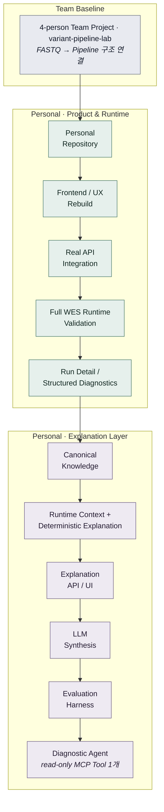
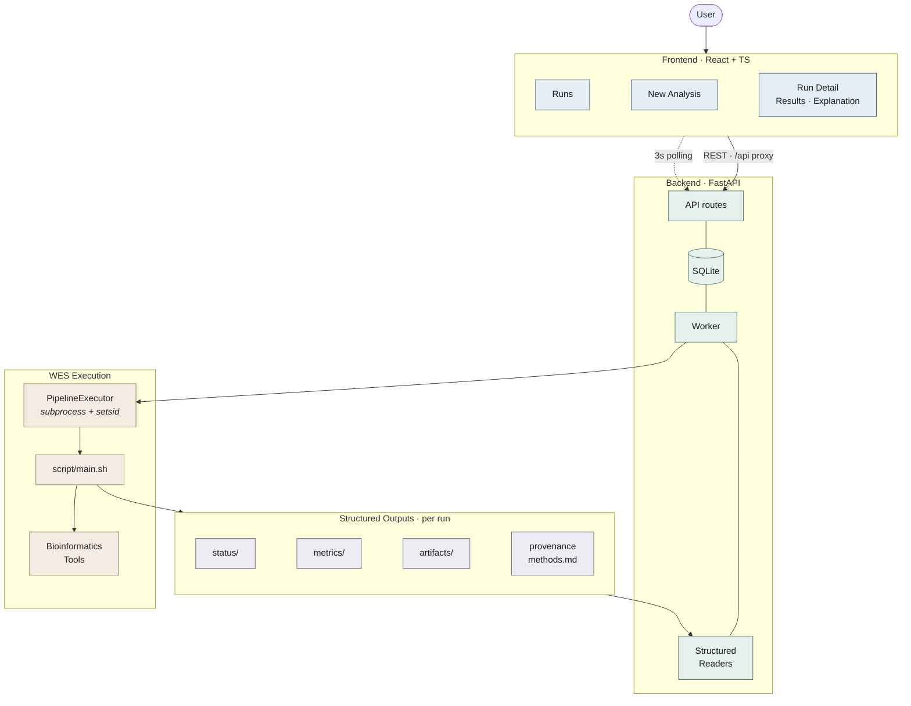
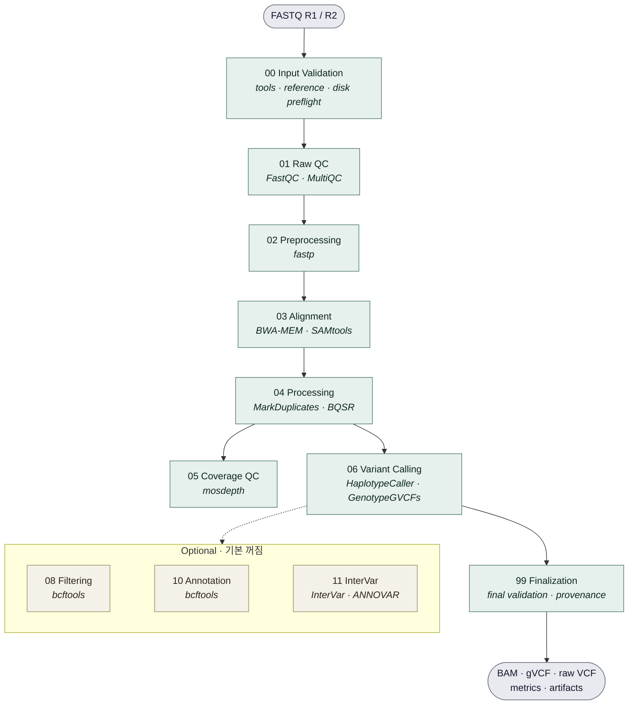
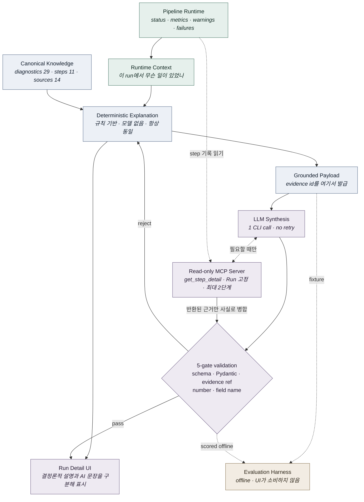

<div align="center">

# 🧬 WES Pipeline Web

**웹에서 WES 분석을 실행하고, 분석 상태·결과·근거 기반 설명까지 연결하는 개인 바이오인포매틱스 프로젝트**

<br/>


</div>

---

<!-- TODO(portfolio): Runs 목록 screenshot -->
<!-- TODO(portfolio): Run Detail / Step Timeline screenshot -->
<!-- TODO(portfolio): Results screenshot -->
<!-- TODO(portfolio): Diagnostic / Explanation screenshot -->
<!-- 추가 시 2열 배치:
| Run Detail | Explanation |
|---|---|
|  |  |
-->

## At a Glance

|  |  |
|---|---|
| **Input** | Paired-end FASTQ (`.fastq.gz` / `.fq.gz`) — sample 1개 + R1/R2 1쌍 |
| **Core output** | analysis-ready BAM · gVCF · **raw VCF (필터링 전)** · coverage metrics · artifacts |
| **Reference** | GRCh38 — assembly는 run config로 선언, 코드에 하드코딩하지 않음 |
| **Web** | React 19 + TypeScript strict ↔ FastAPI + SQLite + single worker |
| **Pipeline** | `script/main.sh` — Bash 단일 파일 (v1.2.0, 5,424줄) + WES 도구 8종 |
| **Explanation** | structured facts + canonical knowledge → deterministic → (선택) LLM synthesis — 필요할 때 읽기 전용 MCP Tool 1개(`get_step_detail`)로 이 Run의 단계 기록을 조회 |
| **Validation** | GIAB HG002 subset으로 `00 → 99` full core run 완주 2회 · fatal error 0 ([Validation](#validation)) |
| **Scope** | Research Use Only · 학습/포트폴리오 prototype · 임상 검증 없음 |

---

## Project Evolution



이 repository는 4인 팀 프로젝트 **[`variant-pipeline-lab`](https://github.com/hgkim1598/variant-pipeline-lab)** 의 최종 상태를 baseline으로 시작했고, **그 이후 개발은 개인적으로 진행했습니다**(baseline import 이후 개인 commit 37건, 이 README 최초 작성일 2026-09-17 기준). 위 흐름은 실제 commit 순서와 그대로 대응합니다.

---

## Key Personal Development

### 🖥️ Web / UX
- 팀 frontend를 전부 제거하고 React 19 + TS strict로 **재구축** (65파일 / 14,820줄 삭제)
- Runs · Run Detail(결과 / 파이프라인 / 파일) · New Analysis wizard 구현
- 탭 노출을 status가 아니라 **응답이 실제로 담고 있는 것**으로 결정 — `failed`여도 남은 산출물은 보여준다

### ⚙️ Backend / Execution
- `GET /api/jobs`(실행 목록) · `/explanation` · `/synthesis` **3개 endpoint 추가** (기존 router 무수정)
- `/results`는 `core_summary.json` 없이 409 → **중간에 죽은 run을 설명할 수 없음** → explanation endpoint 분리
- 모든 응답을 Pydantic / Zod 양쪽에서 검증

### 🧪 WES Validation
- Ubuntu VM + GRCh38 + 실제 도구 8종으로 **`00 → 99` full core run 완주**
- 그 과정에서 pipeline 버그 3건 수정 (BWA index 탐색 · SIGPIPE 오판 · methods 문서 생성)
- 수정이 **런타임에서 실제로 통과**하는 것까지 확인

### 📚 Explanation
- 진단 code의 의미를 `config/knowledge/`로 분리 — **frontend·backend가 같은 파일**을 읽음 (사본 없음)
- runtime context(무슨 일이 있었나)와 knowledge(무슨 뜻인가)를 **분리한 뒤 병합**
- 근거 없는 주장은 **load 시점에 거부** — 모든 claim이 resolvable source id를 가져야 함

### 🤖 LLM Synthesis
- 모델은 DB·로그·artifact를 보지 않고 **deterministic layer를 통과한 payload만** 봄 → 화면과 다른 숫자를 말할 수 없음
- evidence id는 payload가 발급하고, **없는 것을 인용하면 응답 전체 폐기**
- 실패·timeout이어도 deterministic 설명이 그대로 남음

### 📏 Evaluation
- offline harness로 `contextKind` **4종 전부** case 확보
- 금칙어 대신 **인용 관계**로 의미 검사 — `"확정 변이가 아니다"`가 FAIL되는 함정을 피함
- 이것으로 회귀 통제된 개선 1회 수행 — backend 필드명 노출 **31개 키 중 0**

### 🔎 Diagnostic Agent (실험 단계)
- Claude Code CLI를 MCP client로, 직접 구현한 **읽기 전용 MCP 서버의 Tool 1개**(`get_step_detail`)만 쓰게 연결
- 모델은 조회할 **단계만** 고르고 Run은 서버가 고정 · 서로 다른 단계 최대 2개 · Tool이 **실제로 반환한 기록만** 근거로 인정
- 실제 VM Run 2건으로 호출 경로를 **수동 1회** 확인 — Agent 응답 품질의 정량 평가는 아직 없음 ([아래](#diagnostic-agent--구현-범위와-검증-상태))

---

## System Architecture



**Backend는 분석하지 않습니다.** `main.sh`를 실행시키고, `main.sh`가 쓴 구조화 JSON을 읽어 전달할 뿐입니다. SSE는 backend에 구현이 없어(의도적 404) frontend는 3초 polling을 쓰고, terminal 상태에 도달하면 멈춥니다.

---

## WES Workflow



- 단계·의존성은 `main.sh`의 `STEP_KIND` / `STEP_DEPENDS` 선언 그대로 — **05·06은 둘 다 04에 의존**합니다(실행은 순차).
- **core endpoint의 VCF는 필터링 전 raw VCF**입니다. `filteringApplied = false`이고, 화면도 "확정 변이"가 아니라 **후보 변이 기록**으로 표시합니다.
- `02`의 fastp는 `trim_mode=force`일 때만 실행되며, 현재 웹 제출은 `skip`입니다.

---

## Explanation / AI Flow

> **LLM은 분석 결과의 source of truth가 아니라, 확정된 분석 사실을 사용자에게 이해하기 쉽게 전달하는 표현 계층입니다.**



> **deterministic explanation** — 같은 상태에 대해 정해진 규칙과 근거로 동일한 핵심 설명을 만드는 rule-based layer.

| 무엇을 | 어디서 |
|---|---|
| 이 run에서 일어난 일 | **runtime structured data** |
| 진단 code의 일반적 의미 | **canonical knowledge** — source 없는 claim은 load 거부 |
| 사실 기반 1차 설명 | **deterministic layer** — 무료 · 즉시 · 테스트 가능 |
| 사용자 친화적 종합 문장 | **LLM synthesis** — 위 근거 위에서만, 인용과 함께 |
| 특정 단계의 세부 실행 기록 | **read-only MCP Tool** — 모델이 필요할 때 이 Run의 단계 기록을 조회, 서버가 기록한 반환값만 근거로 인정 |

<details>
<summary><b>이 프로젝트에 <i>없는</i> 것</b></summary>

<br/>

RAG · vector database · embedding · knowledge graph · LangChain / LangGraph · multi-agent · 자율적으로 계속 실행되는 agent가 **없습니다.**

Tool 호출은 있지만 범위가 좁습니다. **1회 CLI 호출 안에서 읽기 전용 Tool 1개(`get_step_detail`)로 이 Run의 단계를 최대 2개까지 조회**하는 것이 전부이며, 쓰기 · 재시도 · memory · 사용자 질문 입력은 없습니다 (`synthesis.py` 주석: *"It is a small agent"*). 2026-09-21 이전에는 tool 없는 1회 synthesis였습니다. 진단 knowledge는 29개 규모의 curated 파일이라 retrieval이 필요한 대상이 아니며, **필요를 증명하기 전에 도입하지 않는다**가 이 저장소의 태도입니다.

</details>

### Diagnostic Agent — 구현 범위와 검증 상태

로그와 산출물을 직접 읽기 어려운 사용자를 위해, **실제 Run 기록을 조회해 실행 상태와 문제를 설명하는 구조를 실험**한 것입니다. 상용 서비스나 상주 배포된 agent가 아니며, Run Detail 화면에서 사용자가 직접 실행할 때만 동작합니다.

| 구성 | 내용 | 상태 |
|---|---|---|
| MCP client | Claude Code CLI (구독 로그인 사용) · built-in tool 차단(`--tools ""`) · `--strict-mcp-config` + `--allowedTools`로 이 서버의 Tool만 허용 | 코드 구현 |
| MCP server | `wes-run-evidence` — Python `mcp` SDK, stdio. 요청마다 자식 프로세스로 기동되고 호출이 끝나면 종료 | 코드 구현 |
| Tool | `get_step_detail(stepId)` 1개 — 단계의 status · exit code · checks · metrics · warnings · failures · artifact 수를 반환. 경로 · 파일명 · 시각은 제외하고 sample/run id는 placeholder로 치환 | 코드 구현 |
| 실행 제어 | Run은 서버가 고정(Tool 인자에 Run id 없음) · 서로 다른 단계 최대 2개 · 계획에 없는 단계 거부 · Tool이 실제 반환한 기록만 근거로 인정 · 5-gate 중 하나라도 실패하면 응답 전체 폐기 | 코드 구현 · 단위 테스트 |
| Trace | 모델 · 소요 시간 · turn 수 · 조회한 단계 · 성공 여부 · 오류 분류 6개 필드 (프롬프트 · 생성문 · Tool 반환값은 저장하지 않음) | 코드 구현 · 조회 API 없음 |

| 검증 | 범위 | 결과 |
|---|---|---|
| 코드 경로 테스트 | fake provider와 in-process MCP client로 호출 경로 검사. **실제 모델 · subprocess 호출 없음** | 기본 `pytest` 범위에 포함 ([Validation](#validation)) |
| 실제 CLI → stdio MCP → Tool | 2026-09-22 **수동 1회**. VM의 Run JSON을 read-only GET으로 받아 로컬 임시 DB · runs에 복원해 실행 | `cba73e`(완주 · 경고 3): Tool 미사용 · guardrail 통과 / `68aa20`(`03_alignment` 실패): `03_alignment` 조회 · guardrail 통과. **자동 테스트 없음** |
| Tool 선택 평가 | 합성 case 3개(실패 단계 · 경고 단계 · 조회 불필요)와 채점 함수 | case와 채점 함수는 구현. **실제 모델로 실행한 결과 없음** |
| 설명 품질 | 2026-09-10 단발 synthesis baseline(Agent 연결 이전) 사람 판정 | **Agent 구조의 정량 품질 평가는 아직 없음** |

평가 설계와 남은 과제는 [`docs/AGENT_PLAN.md`](docs/AGENT_PLAN.md)에 정리했습니다.

---

## Engineering Decisions

| Decision | Why |
|---|---|
| **Pipeline ≠ Web** | 분석 로직은 `main.sh`에만. Python으로 재구현하면 두 벌이 언제 어긋났는지 알 수 없다 |
| **Structured status over log parsing** | 진행 상태를 로그 regex로 추측하면, 문구가 바뀌는 순간 조용히 틀린다 |
| **Warning ≠ Failure** | 계속 가능한 데이터 한계와 중단해야 할 오류를 분리. severity(확인 필요한가)와 resolution(이미 처리됐나)도 별개 축 |
| **Deterministic before LLM** | 모델을 먼저 붙이면 사실과 생성의 경계를 되찾을 수 없다. LLM은 선택 기능이 된다 |
| **Evidence-grounded synthesis** | `evidenceRefs`는 스키마상 비어 있을 수 없음 → 근거에 붙일 수 없는 주장은 **표현 자체가 불가능** |
| **Cost boundary in code** | API key 있으면 호출 거부 · 자동 재시도 없음 · eval은 `pytest` 수집 대상 밖 |
| **Read-only, run-scoped tool** | 모델은 단계만 고르고 Run은 서버가 고정한다. 쓰기 경로가 없고, 모델의 진술이 아니라 **Tool이 실제 반환한 기록**만 근거가 된다 |

---

## Validation

| Validation | Result |
|---|---|
| Full WES core run (`00 → 99`) | ✅ `completed_with_warnings` · 8/8 step — 2회 (아래 Run별 표) |
| Reference / Capture kit | GRCh38 · Twist Exome 2.0 |
| Sample | GIAB **HG002 / SRR2962669** 5M paired-end subset |
| Fatal error / failures | **0** / `[]` |
| Core artifacts | analysis-ready BAM · gVCF · **raw VCF** ✅ |
| Backend tests | ✅ **489 passed · 1 skipped** — `cd backend && .venv/Scripts/python.exe -m pytest` (기본 범위 `app/tests`, 2026-10-28 실행) |
| Eval scorer tests | ✅ **50 passed** — backend에서 `.venv/Scripts/python.exe -m pytest evals/test_evaluators.py` (채점 함수 테스트 · 모델 호출 없음, 2026-10-28 실행) |
| Frontend typecheck / build | ✅ `tsc -b` strict · `vite build` (2026-10-28 실행) |

backend 테스트의 Agent 관련 부분은 fake provider와 in-process MCP client를 쓰며, **실제 LLM 응답 품질을 측정한 결과가 아닙니다.**

**Run별 핵심 수치** — 두 Run은 같은 SRR2962669의 **서로 다른 5M 구간**이며 독립된 biological sample이 아닙니다. 수치는 Run 단위로만 읽습니다.

| Run | 입력 | 결과 | 실행 시간 | raw variant records | warnings |
|---|---|---|---|---|---|
| `wes-20260907-014650-fcb1c2` | 앞 5M pairs (`subset_5M`) | 8/8 · FAIL 0 · artifacts 37건(API) | **5,112초**(≈1h 25m, API `elapsedSeconds`) | **52,379** | `NM_MD_REPAIRED` / `UNCOVERED_TARGETS` / `DBSNP_NOT_CONFIGURED` |
| `wes-20260918-222933-cba73e` | 뒤 5M pairs (`tail_5M`) | 8/8 · `main.sh` exit 0 · `core_complete=true` | ≈3h 43m (job 시작 → 종료 시각) | **52,294** | `NM_MD_REPAIRED` / `ZERO_COVERAGE_TARGET_BASES` / `DBSNP_NOT_CONFIGURED` |

raw variant records는 **필터링 전 후보 기록**이며 확인된 변이나 병원성 변이의 수가 아닙니다.

> ⚠️ **pipeline 실행 성공 ≠ variant calling 정확도 검증.** truth set(GIAB benchmark / hap.py) 기반 sensitivity·precision 평가는 **수행하지 않았습니다.** 검증된 것은 전 경로가 실제로 끝까지 동작한다는 기술적 사실입니다.

---

## Troubleshooting

| Case | 확인 | 판단 |
|---|---|---|
| **UNCOVERED_TARGETS** | mosdepth 결과 확인 · `main.sh` coverage 정책에 임의 임상 임계값이 없음을 확인 | 5M subset의 저심도 한계지만 **실제 데이터 사실** → warning 유지, 설명 계층이 이유를 서술 |
| **INVALID_TAG_NM / NM_MD_REPAIRED** | 해당 BAM record 37건을 추출해 GRCh38 reference를 직접 조회 | 원인은 **reference의 ambiguous base(`N`)** → 파이프라인 오류 아님. 안전장치 유지 + `resolution` 축으로 표현 분리 |

---

## Tech Stack

| Layer | Technology | Role |
|---|---|---|
| **Frontend** | React 19 · TypeScript strict · Vite 8 · TanStack Query · Zod · Tailwind v4 · Base UI | 서버 상태 polling, 응답은 파싱 후에만 화면에 진입 |
| **Backend** | Python 3.12 · FastAPI · SQLite(stdlib) · threading + queue · subprocess/setsid | API · job 저장 · single worker · 재시작해도 분석이 죽지 않음 |
| **Bioinformatics** | FastQC · MultiQC · fastp · BWA-MEM · SAMtools · GATK · mosdepth · bcftools · (InterVar) | `main.sh`가 호출. 파이프라인은 소프트웨어를 설치하지 않음 |
| **Explanation / AI** | Pydantic contract · shared JSON knowledge · Claude Code CLI (subprocess + JSON schema) · MCP Python SDK (stdio) | deterministic 계층 + 구독 전용 LLM synthesis + 읽기 전용 Tool 1개 |
| **Testing** | pytest (489 passed · 1 skipped, 2026-10-28) · offline eval harness · oxlint · tsc strict | eval은 `testpaths` 밖 — 맨 `pytest`는 0건 수집 |

**Dev env** — Windows에서 frontend/backend 개발, **Ubuntu VM(VirtualBox)** 에서 실제 WES 실행 (conda env 2개: `wes-dev` = FastAPI, `wes-tools` = 분석 도구)

---

## Repository Structure

```text
wes-pipeline-web/
├── front/                              # React UI
│   └── src/features, registries/       #   runs · run-detail · new-analysis / steps · knowledge
├── backend/
│   ├── app/api/                        # uploads · jobs · results · steps · explanation · synthesis
│   ├── app/services/                   # worker · pipeline_executor · config_builder · *_reader
│   ├── app/services/explanation/    ★  # knowledge · run_context · deterministic · llm/
│   ├── app/agent_mcp/               ★  # read-only MCP server (get_step_detail)
│   ├── app/tests/                      # pytest (기본 범위)
│   └── evals/                       ★  # offline LLM evaluation harness
├── script/main.sh                      # 실제 WES pipeline (v1.2.0, 단일 파일)
├── config/knowledge/                ★  # canonical domain knowledge (front·back 공용)
├── config/capture_kits.grch38.json     # capture kit registry
└── docs/                               # 설계 계획서 · pipeline 가이드 · BED 출처
```

★ = 팀 baseline 이후 개인 추가 영역

---

## Getting Started

<details>
<summary><b>Web development setup</b> — 분석 도구 없이 동작 (<code>check_only</code>)</summary>

<br/>

```bash
# Backend (Windows)
py -3.12 -m venv backend\.venv
backend\.venv\Scripts\python.exe -m pip install -r backend\requirements-dev.txt
cp backend/.env.example backend/.env      # 이 머신의 값으로 채운다

backend/.venv/Scripts/python.exe -m uvicorn app.main:app --app-dir backend --port 8000
cd backend && .venv/Scripts/python.exe -m pytest
```

```bash
# Frontend
cd front && npm install
npm run dev          # http://localhost:5173  (/api → 127.0.0.1:8000 proxy)
npm run typecheck && npm run lint && npm run build
```

Linux / macOS는 `python3.12 -m venv backend/.venv` 후 `backend/.venv/bin/python`을 사용합니다.

`.env` 값을 모르면 **비워 둡니다.** `main.sh`는 fail-closed이고, 잘못된 reference가 빈 값보다 훨씬 나쁩니다.

AI 설명(LLM synthesis · Diagnostic Agent)은 선택 기능이며, 로그인된 Claude Code CLI가 있어야 동작합니다. 설정 항목은 `backend/.env.example`의 `WES_SYNTHESIS_*`를 참고하세요. Linux 배포 환경의 CLI 설정 절차는 아직 문서화하지 않았습니다.

</details>

<details>
<summary><b>Full WES environment</b> — Linux 필요</summary>

<br/>

> ⚠️ Windows에서 web 개발이 된다고 해서 full WES pipeline이 Windows에서 도는 것은 아닙니다.

**도구** (PATH에 있어야 함 — `main.sh`는 아무것도 설치하지 않습니다)
`bwa` · `samtools` · `gatk` · `bcftools` · `tabix`/`bgzip` · `mosdepth` · `fastqc` (+선택 `multiqc` · `fastp`)

**Reference bundle** (`backend/.env` 또는 run config로 선언)

| | |
|---|---|
| reference FASTA | GRCh38 + `.fai` + `.dict` |
| BWA index | `.amb` `.ann` `.bwt` `.pac` `.sa` |
| known sites | BQSR용 VCF 목록 |
| dbSNP VCF | 선택 — rsID 부여 전용 |
| capture BED | `script/download_capture_beds.sh` · 출처는 [`docs/CAPTURE_BED_RESOURCES.md`](docs/CAPTURE_BED_RESOURCES.md) |
| contig style | `.fai` 첫 컬럼을 **직접 읽고** `chr` / `plain` 선언 (추측 금지) |

**InterVar / ACMG** (선택) — `WES_INTERVAR_DIR` · `_BUILD` · `_HUMANDB`를 **셋 다 설정하거나 셋 다 비웁니다.** 일부만 설정하면 startup에서 거부되고, 미설정이면 UI 옵션이 `unsupportedOptions`로 되돌아옵니다.

```bash
bash script/main.sh --config <run_config.json>               # 전체
bash script/main.sh --config <run_config.json> --check-only  # preflight만
```

</details>

---

## Limitations

- **Research Use Only** — 임상 진단 목적이 아니며 clinical validation 없음
- **variant calling accuracy 미검증** — truth set 기반 sensitivity·precision 측정 안 함
- **full-run 검증은 5M read subset 기준** — coverage 수치는 이 입력 조건의 결과
- **optional steps**(filtering / annotation / InterVar)는 구현되어 있으나 **실행 검증 안 함**
- **single worker · 인증 없음** — 로컬 / 단일 운영자 환경 전제
- **local reference resources 필요** — 파이프라인이 reference를 내려받지 않음
- **LLM explanation은 분석 사실의 출처가 아니며 medical advice가 아님**
- **Diagnostic Agent는 실험 단계** — Tool 1개 · 실제 CLI→MCP 경로는 수동 1회 확인 · Agent 응답 품질의 정량 평가 없음 · 상주 배포된 서비스 아님
- **synthesis API는 미완료 Run 요청을 막지 않음** — 현재는 UI에서만 버튼을 비활성화

---

## Roadmap

1. **Stale `running` 상태 정합성** — 프로세스가 없고 job이 terminal이면 API가 `running`을 반환하지 않는다는 invariant를 코드·테스트로 확립
2. **영속 데이터와 release lifecycle 분리** — `runs` / `uploads` / DB가 release 디렉터리에 묶여 재배포가 과거 run을 깨뜨리는 구조 해소
3. **Optional step 도입 조건** — `08_filtering`은 HG002 truth set으로 **성능을 먼저 평가한 뒤** 켠다
4. **Evaluation 확장** — 실패한 run payload에 단계 요약 추가, human review 기록, CI 연결 결정
5. **Diagnostic Agent 측정** (계획 · [`docs/AGENT_PLAN.md`](docs/AGENT_PLAN.md) P0) — 실제 stdio MCP 경로 자동 smoke 테스트, Tool 없음 / 규칙 기반 / Agent의 반복 비교 평가, 실측 Run을 평가 case로 사용. **분석 지식 RAG와 추가 Tool은 평가에서 필요가 확인될 때만 착수**(P2)

---

## Team Project Origin & Docs

> 이 프로젝트는 4인 팀 프로젝트 **[`variant-pipeline-lab`](https://github.com/hgkim1598/variant-pipeline-lab)** 의 최종 결과를 baseline으로 시작했으며, 팀 프로젝트 종료 이후의 개발은 이 repository에서 개인적으로 진행하고 있습니다. 팀 시점의 pipeline·backend 구조와 팀원별 역할은 원본 저장소에 기록되어 있습니다.

| 문서 | 내용 |
|---|---|
| [`docs/WES_DESIGN_PLAN.md`](docs/WES_DESIGN_PLAN.md) | UX/UI 설계 계획서 — 모든 결정에 근거와 출처 등급 표기 |
| [`docs/MAIN_SH_COMPLETE_GUIDE.md`](docs/MAIN_SH_COMPLETE_GUIDE.md) | `main.sh` 전체 가이드 — 단계 · config · 상태 파일 스키마 |
| [`docs/AGENT_PLAN.md`](docs/AGENT_PLAN.md) | Diagnostic Agent 현황 · 평가 계획 · 설계 결정 기록 — 구현 / 검증 부족 / 미구현을 구분 |
| [`docs/DEPLOYMENT.md`](docs/DEPLOYMENT.md) | Linux 서버 배포 · 기동 · preflight 절차 |
| [`WES_CODEBASE_AUDIT_20260823.md`](WES_CODEBASE_AUDIT_20260823.md) | 팀 프로젝트 종료 시점의 정적 코드 감사 |
| [`script/README.md`](script/README.md) · [`backend/README.md`](backend/README.md) · [`front/README.md`](front/README.md) | 각 영역별 상세 |
| [`CLAUDE.md`](CLAUDE.md) | 이 저장소의 구현 규칙 — 사실 우선, 기능 날조 금지 |
